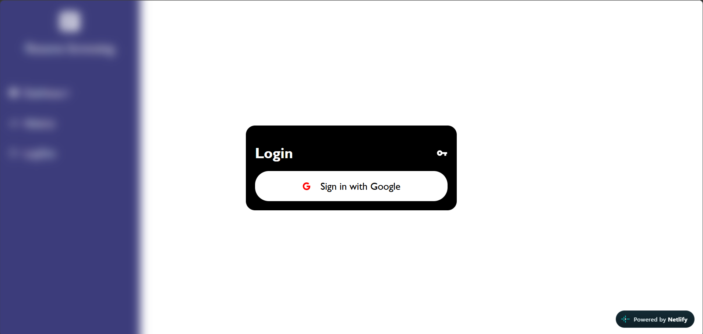
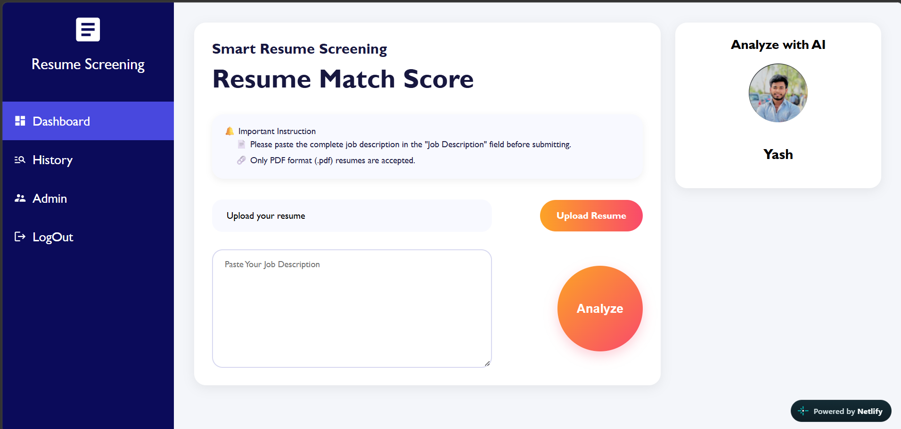
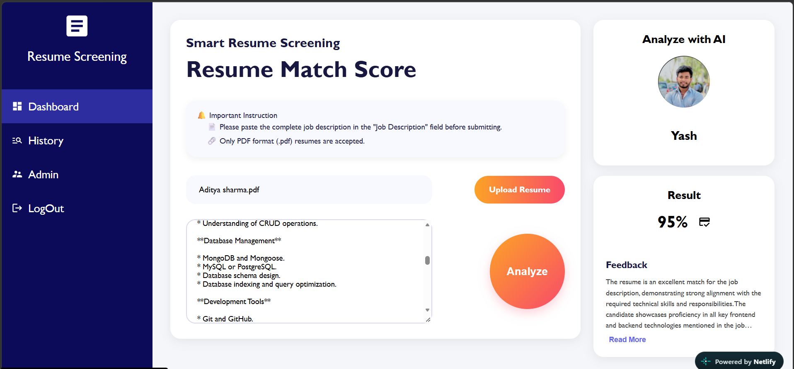
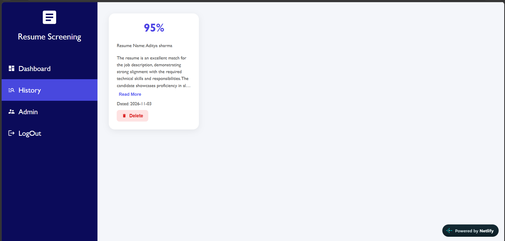
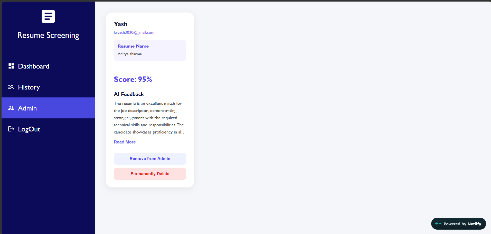

# AI Resume Analyzer 🚀

An AI-powered Resume Analyzer built using the MERN Stack that helps users analyze their resumes, evaluate skills, identify relevant keywords, and receive AI-generated feedback.

🔗 **Live Demo:** [AI Resume Analyzer](https://ai-resume-analyzing.netlify.app/)

💻 **GitHub Repository:** [AI Resume Analyzer](https://github.com/Yash-bot-max/AI-Resume-Analyzer)

---

## 📌 Overview

AI Resume Analyzer is a full-stack web application designed to help job seekers improve their resumes using Artificial Intelligence.

Users can upload their resumes in PDF format and receive AI-powered analysis, including relevant feedback and insights. The application also provides resume history management and an admin dashboard.

The project integrates the Cohere AI API for AI-powered resume analysis and Firebase Authentication for secure Google login.

---

## ✨ Features

* **Google Authentication:** Secure login using Firebase Authentication.
* **Resume Upload:** Upload resumes in PDF format.
* **AI-Powered Analysis:** Analyze resumes using the Cohere API.
* **Resume Feedback:** Generate useful insights and suggestions.
* **Resume History:** View previously analyzed resumes.
* **Admin Dashboard:** Dedicated dashboard for administrative management.
* **REST API Integration:** Communication between frontend and backend.
* **MongoDB Database:** Store and manage application data.
* **Responsive UI:** User-friendly interface.

---

## 🖥️ Screenshots

### 1. Login Page



### 2. Dashboard



### 3. Resume Analysis



### 4. Resume History



### 5. Admin Dashboard



---

## 🛠️ Tech Stack

### Frontend

* React.js
* Vite
* JavaScript
* HTML5
* CSS3
* Axios
* React Router
* Firebase Authentication

### Backend

* Node.js
* Express.js
* MongoDB
* Mongoose
* Firebase Admin SDK
* Multer
* PDF Parser

### AI Integration

* Cohere API

### Deployment

* Netlify – Frontend
* Render – Backend
* MongoDB Atlas – Database

---

## 📂 Project Structure

```text
AI-Resume-Analyzer/
│
├── backend/
│   ├── config/
│   ├── controllers/
│   ├── middleware/
│   ├── models/
│   ├── routes/
│   ├── utils/
│   ├── index.js
│   ├── package.json
│   └── .env.example
│
├── frontend/
│   ├── public/
│   ├── src/
│   ├── index.html
│   ├── package.json
│   ├── vite.config.js
│   └── .env.example
│
├── screenshots/
│   ├── login.png
│   ├── dashboard.png
│   ├── resume-analysis.png
│   ├── history.png
│   └── admin-dashboard.png
│
└── README.md
```
*Note: The folder structure above is a simplified overview. Actual subfolders may vary.*

---

## ⚙️ Installation & Setup

Follow these steps to run the project locally.

### 1. Clone the Repository

```bash
git clone https://github.com/Yash-bot-max/AI-Resume-Analyzer.git
```

```bash
cd AI-Resume-Analyzer
```

### 2. Backend Setup

```bash
cd backend
npm install
```

Create a `.env` file inside the backend folder and configure:

```env
PORT=4000
MONGO_URI=your_mongodb_connection_string
COHERE_API_KEY=your_cohere_api_key
FRONTEND_URL=http://localhost:5173
FIREBASE_SERVICE_ACCOUNT=your_firebase_service_account_json
```

Also place your Firebase Admin service account JSON file at the location expected by the backend configuration when using the local JSON credential method.

### 3. Frontend Setup

Open another terminal:

```bash
cd frontend
npm install
```

Create a `.env` file inside the frontend folder:

```env
VITE_API_URL=http://localhost:4000
```

### 4. Run the Application

Start the backend:

```bash
cd backend
npm run dev
```

Start the frontend in another terminal:

```bash
cd frontend
npm run dev
```

Open the local development URL:

```text
http://localhost:5173
```

---

## 🔐 Environment Variables

| Variable                   | Description                          |
| -------------------------- | ------------------------------------ |
| `PORT`                     | Backend server port                  |
| `MONGO_URI`                | MongoDB connection string            |
| `COHERE_API_KEY`           | Cohere API key                       |
| `FRONTEND_URL`             | Frontend URL allowed by backend CORS |
| `FIREBASE_SERVICE_ACCOUNT` | Firebase Admin service account JSON  |
| `VITE_API_URL`             | Backend API URL used by frontend     |

**Important:** Never upload `.env`, Firebase service account credentials, private keys, or API keys to GitHub.

---

## 🚀 Live Deployment

| Service  | Platform                                                       |
| -------- | -------------------------------------------------------------- |
| Frontend | [Netlify](https://ai-resume-analyzing.netlify.app/)            |
| Backend  | [Render](https://ai-resume-analyzer-backend-92j5.onrender.com) |
| Database | MongoDB Atlas                                                  |

---

## 🎯 Learning Outcomes

Through this project, I gained practical experience in:

* Building a full-stack MERN application.
* Integrating third-party AI APIs.
* Implementing Firebase Authentication.
* Developing RESTful APIs using Express.js.
* Managing data using MongoDB and Mongoose.
* Handling PDF uploads and text extraction.
* Connecting frontend and backend services.
* Deploying a full-stack application.

---

## 🔮 Future Improvements

* More detailed resume scoring and evaluation.
* Job description and resume matching.
* Additional resume improvement recommendations.
* Downloadable analysis reports.
* Enhanced analytics and dashboard insights.

---

## 👨‍💻 Developer

**Yash**

[GitHub](https://github.com/Yash-bot-max)

---

⭐ If you find this project interesting, consider giving it a star!
